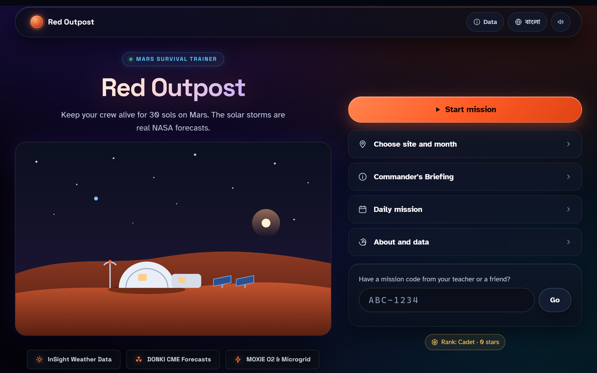
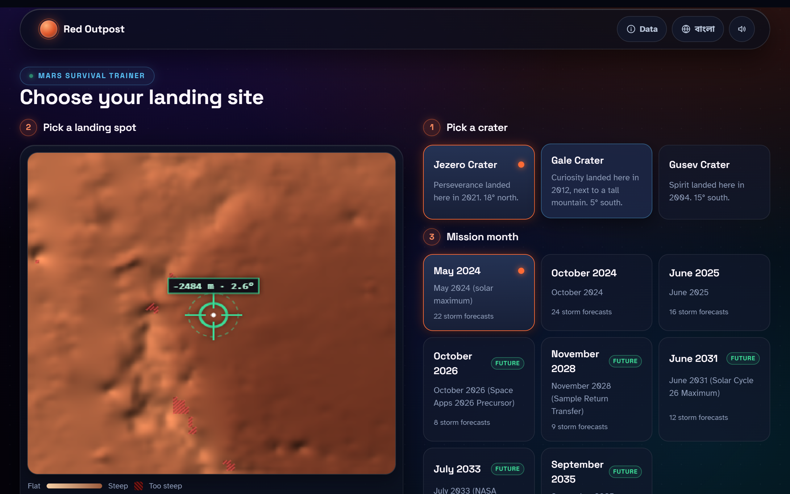
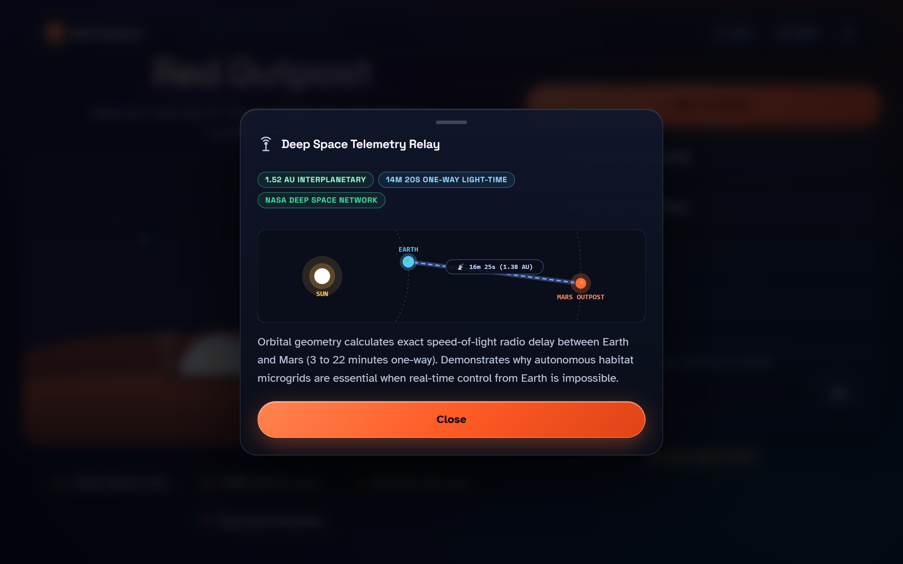
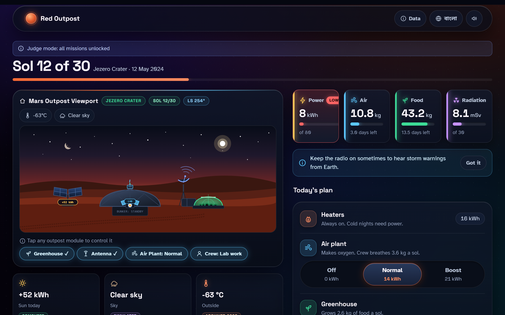
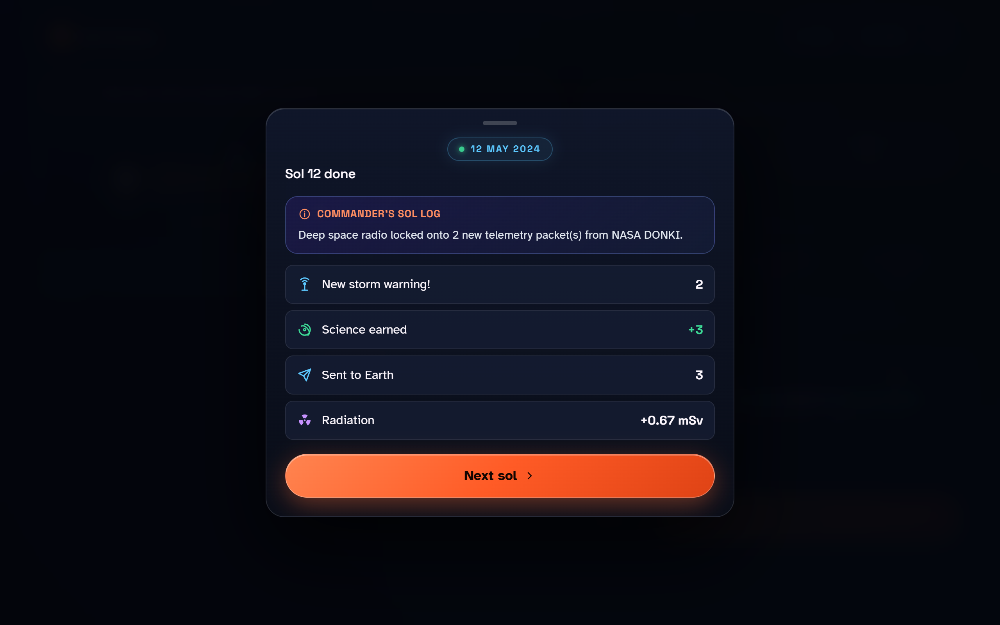
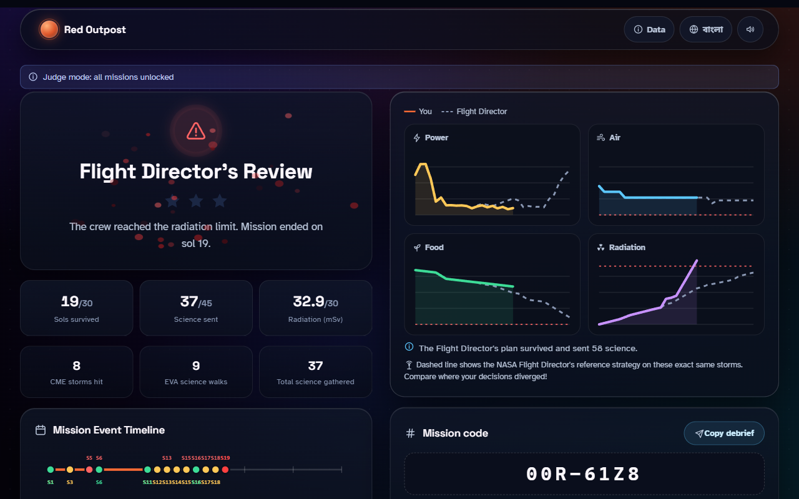
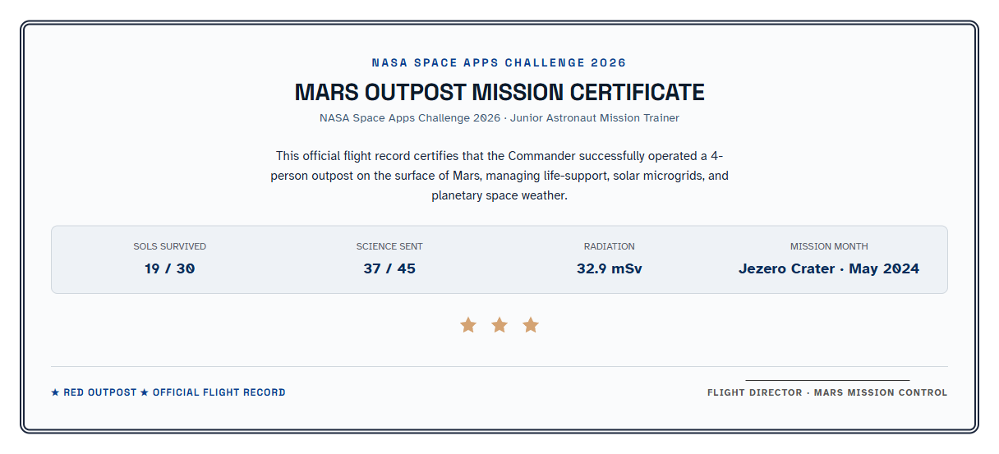
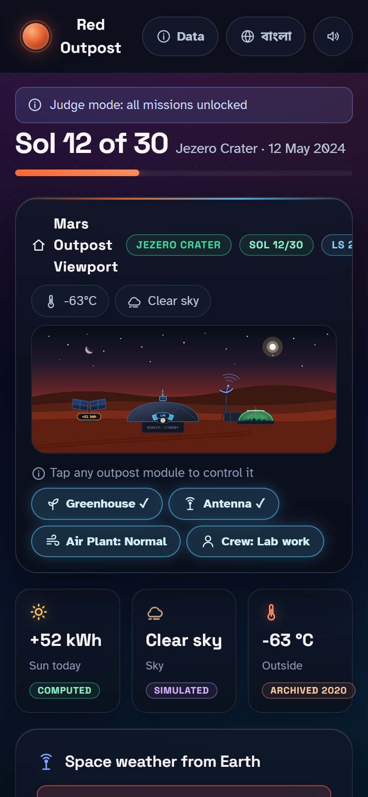
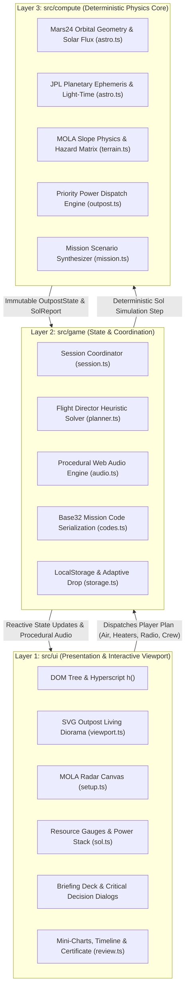
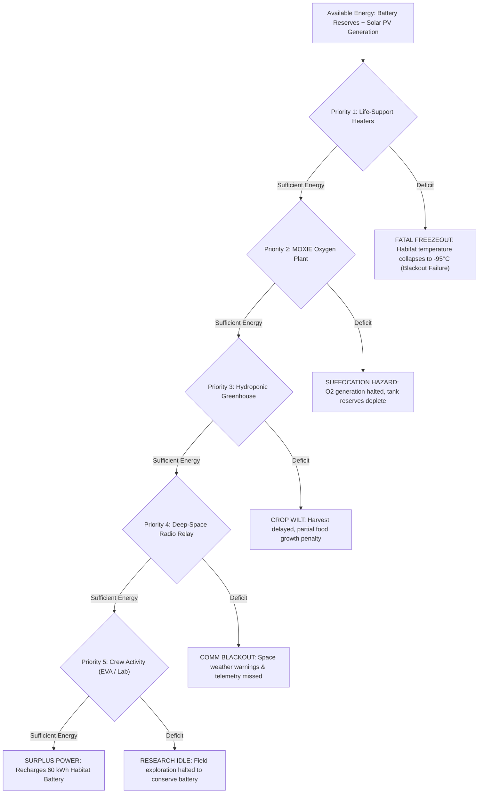

# Red Outpost: Mars Survival Trainer

**NASA Space Apps Challenge 2026 · Challenge: [Junior Astronaut Mission Trainer](https://www.spaceappschallenge.org/2026/challenges/junior-astronaut-mission-trainer/)**  
*(Track: Living Beyond Earth / Space Exploration Systems & Gamified Education · Intermediate / Beginner-Youth)*  
**Live Interactive Application:** [https://maverickmaruf.github.io/redpost/](https://github.com/maverickmaruf/redpost.git)  

> *"Picture this: it's Sol 214 on a lunar outpost, a dust storm just rolled in, your solar panels are about to get buried, and you have about 10 seconds to decide: do you retract the panels and lose power tonight, or leave the exposed panels and risk losing a lot more? That single decision is the entire spirit of this challenge. Your challenge is to design and build an interactive game or app where kids ages 7 to 12 run a lunar or Martian outpost, making real decisions about life support, radiation shielding, power budgeting, food production, and communication delay, and then watching those consequences play out. Not a quiz. Not a slideshow. A living simulation where every choice costs something... putting someone in the commander's seat and making them own their consequences."*  
> — **Mike Givens**, Challenge Author (NASA / Kakhi International)

---

## Quick Start & Play

```bash
# Clone the repository
git clone https://github.com/maverickmaruf/redpost.git
cd redpost

# Install dependencies and start the local dev server
npm install
npm run dev
```

Open `http://localhost:5173/` in your browser.

### 🚀 Judge Mode Shortcut
For competition judges and evaluators who want to inspect the record-breaking May 2024 solar storm immediately without playing through earlier sols:
- Append `?judge=1` to the URL: `http://localhost:5173/?judge=1`
- **OR** tap the Mars habitat hero illustration on the Title screen **5 times**.  
*This automatically fast-forwards through the Flight Director's first 11 sols at Jezero Crater and places you in the Commander's seat directly on Sol 12, the day before the largest CME in modern history hits.*

---

## 📸 Visual Showcase & Interactive Walkthrough

The following screenshots illustrate the core interactive experience of **Red Outpost**, designed to put young explorers directly in the Commander's seat with authentic NASA telemetry, tactile Martian dioramas, and high-stakes survival trade-offs:

| 01. Title Screen & Mission Control Deck | 02. Junior Astronaut Flight Briefing |
|:---:|:---:|
| [](docs/screenshots/01_title_screen.png) | [](docs/screenshots/02_briefing_deck.png) |
| *Landing page with isometric habitat art, astronaut rank badge, and live telemetry highlights.* | *Interactive onboarding slide deck teaching power constraints, life support, and CME shielding.* |

| 03. MOLA Landing Site Radar & Slope Map | 04. Deep Space Telemetry & Planetary Relay |
|:---:|:---:|
| [](docs/screenshots/03_mission_setup.png) | [](docs/screenshots/04_earth_mars_relay.png) |
| *NASA MOLA laser-altimeter shaded relief map with interactive slope clearance crosshairs.* | *Real-time astronomical model displaying interplanetary distance (AU) and light-time delay.* |

| 05. Sol Command Center & Living Viewport | 06. Commander's Critical Decision Gate |
|:---:|:---:|
| [](docs/screenshots/05_sol_command.png) | [](docs/screenshots/06_critical_decision.png) |
| *Interactive SVG habitat diorama, 4 resource gauges, power budget stack, and DONKI alert card.* | *High-stakes emergency choice: order crew into bunker shelter or risk EVA radiation for science.* |

| 07. Flight Director's Mission Review | 08. Official Printable Flight Certificate |
|:---:|:---:|
| [](docs/screenshots/07_review_charts.png) | [](docs/screenshots/08_flight_certificate.png) |
| *4 comparative mini-charts vs NASA Ghost reference solver, event timeline, and particle confetti.* | *Printable NASA Space Apps Junior Astronaut flight diploma with custom cadet name & mission seal.* |

| 09. Touch-Optimized Mobile Viewport (iPhone / Android) |
|:---:|
| [](docs/screenshots/09_mobile_command.png) |
| *Full responsive layout delivering the complete 5-pillar simulation on budget mobile devices.* |

---

## Table of Contents
- [📸 Visual Showcase & Interactive Walkthrough](#-visual-showcase--interactive-walkthrough)
1. [Executive Summary & Challenge Philosophy](#1-executive-summary--challenge-philosophy)
2. [Architectural Overview & Core Design Principles](#2-architectural-overview--core-design-principles)
3. [The Five Core Pillars of Deep-Space Survival](#3-the-five-core-pillars-of-deep-space-survival)
   - [3.1 Power Budgeting & Martian Microgrid](#31-power-budgeting--martian-microgrid)
   - [3.2 Life Support & MOXIE Oxygen Generation](#32-life-support--moxie-oxygen-generation)
   - [3.3 Food Production & Hydroponic Greenhouse](#33-food-production--hydroponic-greenhouse)
   - [3.4 Radiation Shielding & NASA DONKI Space Weather](#34-radiation-shielding--nasa-donki-space-weather)
   - [3.5 Deep-Space Communication Delay & Autonomous Operations](#35-deep-space-communication-delay--autonomous-operations)
4. [Mathematical & Scientific Models (`src/compute/`)](#4-mathematical--scientific-models-srccompute)
   - [4.1 Solar Geometry & GISS Mars24 Insolation (`astro.ts`)](#41-solar-geometry--giss-mars24-insolation-astrots)
   - [4.2 JPL Planetary Ephemeris & Light-Time (`astro.ts`)](#42-jpl-planetary-ephemeris--light-time-astrots)
   - [4.3 MOLA MEGDR Laser-Altimeter Slope Physics (`terrain.ts`)](#43-mola-megdr-laser-altimeter-slope-physics-terraints)
   - [4.4 Outpost State Machine & Priority Power Dispatch (`outpost.ts`)](#44-outpost-state-machine--priority-power-dispatch-outpostts)
   - [4.5 NASA Flight Director Heuristic Solver (`planner.ts`)](#45-nasa-flight-director-heuristic-solver-plannerts)
5. [Game State, Audio & Storage Engine (`src/game/`)](#5-game-state-audio--storage-engine-srcgame)
   - [5.1 Session Replay & Deterministic Saves (`session.ts`)](#51-session-replay--deterministic-saves-sessionts)
   - [5.2 31-Bit Base32 Mission Codes (`codes.ts`)](#52-31-bit-base32-mission-codes-codests)
   - [5.3 Synthesized Procedural Web Audio (`audio.ts`)](#53-synthesized-procedural-web-audio-audiots)
   - [5.4 LocalStorage & Adaptive Difficulty (`storage.ts`)](#54-localstorage--adaptive-difficulty-storagets)
6. [User Interface & Interactive Diorama (`src/ui/`)](#6-user-interface--interactive-diorama-srcui)
   - [6.1 Living Outpost Viewport (`viewport.ts`)](#61-living-outpost-viewport-viewportts)
   - [6.2 Earth-Mars Telemetry Relay Diagram (`relay.ts`)](#62-earth-mars-telemetry-relay-diagram-relayts)
   - [6.3 Title Screen & Commander's Highlights (`title.ts`)](#63-title-screen--commanders-highlights-titlets)
   - [6.4 Mission Setup & Radar Targeting (`setup.ts`)](#64-mission-setup--radar-targeting-setupts)
   - [6.5 Sol Command Center & Critical Decision Gates (`sol.ts`)](#65-sol-command-center--critical-decision-gates-solts)
   - [6.6 Junior Astronaut Flight Briefing Deck (`briefing.ts`)](#66-junior-astronaut-flight-briefing-deck-briefingts)
   - [6.7 Flight Director's Review & Printable Certificate (`review.ts`)](#67-flight-directors-review--printable-certificate-reviewts)
   - [6.8 Scientific Provenance & About Console (`about.ts`, `provenance.ts`)](#68-scientific-provenance--about-console-aboutts-provenancets)
   - [6.9 Mobile Responsive Interface](#69-mobile-responsive-interface)
7. [Complete File-by-File Codebase Directory](#7-complete-file-by-file-codebase-directory)
8. [NASA Data Pipeline & Provenance System](#8-nasa-data-pipeline--provenance-system)
9. [Bilingual System & Internationalization (`i18n.ts`)](#9-bilingual-system--internationalization-i18nts)
10. [Verification, Testing & Quality Assurance](#10-verification-testing--quality-assurance)
11. [Running, Building, and Deploying](#11-running-building-and-deploying)
12. [License & Credits](#12-license--credits)

---

## 1. Executive Summary & Challenge Philosophy

The **Junior Astronaut Mission Trainer Challenge** calls for an interactive web experience that teaches young explorers (ages 7–12) how NASA maintains human life beyond Earth.

As NASA contractor and challenge author **Mike Givens (Kakhi International)** stated:
> *"Picture this: it's Sol 214 on a lunar outpost, a dust storm just rolled in, your solar panels are about to get buried, and you have about 10 seconds to decide: do you retract the panels and lose power tonight, or leave the exposed panels and risk losing a lot more? That single decision is the entire spirit of this challenge.*  
> *Your challenge is to design and build an interactive game or app where kids ages 7 to 12 run a lunar or Martian outpost, making real decisions about life support, radiation shielding, power budgeting, food production, and communication delay, and then watching those consequences play out.*  
> *Not a quiz. Not a slideshow. A living simulation where every choice costs something... putting someone in the commander's seat and making them own their consequences."*

**Red Outpost** was engineered from the ground up to embody this exact philosophy. There is no "unlimited resource mode" in space:
- Every watt of power allocated to science is a watt denied to life support or battery buffering.
- Every EVA spacewalk into the Martian terrain generates invaluable scientific knowledge, but expends battery power and exposes astronauts to ionizing solar proton flux.
- Every radio transmission sent to Earth consumes energy, but is the only conduit to receive NASA DONKI space weather warnings before coronal mass ejections (CMEs) arrive.

The app is **100% offline-first**, contains **zero trackers, zero cookies, and zero advertisements**, runs smoothly on budget mobile phones, and provides full bilingual parity in **English** and **বাংলা (Bengali)**.

---

## 2. Architectural Overview & Core Design Principles

The application is structured into strict, decoupled layers:

```
┌─────────────────────────────────────────────────────────────┐
│                       src/ui/ (DOM)                         │
│  Reactive views, SVG Diorama, Telemetry Gauges, Modals      │
└──────────────────────────────┬──────────────────────────────┘
                               │ Dispatches Plans & Triggers
┌──────────────────────────────▼──────────────────────────────┐
│                      src/game/ (State)                      │
│  Session, Saves, Heuristic Solver, Procedural Audio, Codes  │
└──────────────────────────────┬──────────────────────────────┘
                               │ Pure Functional Calls
┌──────────────────────────────▼──────────────────────────────┐
│                    src/compute/ (Physics)                   │
│  Mars24 Orbit, JPL Ephemeris, MOLA Slopes, Outpost Steps    │
│  (STRICT: No DOM, No Window, No Network, Zero Randomness)   │
└─────────────────────────────────────────────────────────────┘
```



### Key Architectural Rules:
1. **Strict Separation of Compute (`src/compute/`):**  
   The mathematical core has zero dependencies on DOM APIs, browser clocks (`Date.now()`), network calls (`fetch`), or non-deterministic randomness (`Math.random()`). All math is purely deterministic and fully unit-tested with Vitest. An automated ESLint boundary rule prevents any DOM or browser imports from entering `src/compute/`.
2. **Deterministic Save-by-Replay Engine (`src/game/session.ts`):**  
   Game saves do not serialize large, fragile state objects. Instead, saves store only the initial mission setup and the sequence of player decisions `Plan[]`. The entire 30-sol state is reconstructed deterministically by replaying decisions through the compute core, preventing state corruption across updates.
3. **Pre-Compiled Zero-Network Pipeline (`scripts/acquire/`):**  
   All NASA data (MOLA MEGDR topography grids, InSight weather telemetry, DONKI WSA-ENLIL heliospheric simulations) is acquired and verified at build time and bundled directly into static JSON fixtures. At runtime, the client makes zero HTTP network requests.
4. **Accessible, Ultra-Lightweight DOM (`src/ui/dom.ts`):**  
   All DOM elements are constructed using a lightweight typed hyperscript helper `h()`. No heavy frontend framework (React, Vue, or Angular) is used, keeping the bundle size minuscule (~157 kB uncompressed, ~51 kB gzipped) with near-instant load times on low-end hardware.

---

## 3. The Five Core Pillars of Deep-Space Survival

Red Outpost models the five critical deep-space trade-offs outlined by NASA:

### 3.1 Power Budgeting & Martian Microgrid
- **Solar Insolation:** Sunlight on Mars is less than half as intense as on Earth ($\approx 586\text{ W/m}^2$ mean vs $1361\text{ W/m}^2$). The actual insolation per sol varies with Mars' eccentric orbit ($e = 0.0934$), its axial tilt ($25.19^\circ$), and landing latitude.
- **Dust Opacity ($\tau$):** Atmospheric dust scatters sunlight according to Beer-Lambert extinction ($\text{Transmission} = e^{-0.4\tau}$).
- **Habitat Heaters:** Outside temperatures drop to $-95^\circ\text{C}$ during Martian nights (derived from NASA InSight TWINS measurements). Electric thermal heaters require $16\text{--}24\text{ kWh/sol}$ to maintain the habitat at $+20^\circ\text{C}$. Heaters occupy Priority 1: if heaters lose power, the habitat experiences fatal freezeout blackout.
- **Battery Buffering:** Surplus daylight energy charges a $60\text{ kWh}$ battery. Nighttime heaters and subsystems draw from this reserve.

### 3.2 Life Support & MOXIE Oxygen Generation
- **Metabolic Requirement:** A four-person crew consumes $3.58\text{ kg } \text{O}_2/\text{sol}$ ($0.895\text{ kg}$ per astronaut per sol, cited from NASA BVAD).
- **In-Situ Resource Utilization (ISRU):** Modeled directly on the **MOXIE** instrument aboard NASA's Perseverance rover, which uses Solid Oxide Electrolysis to split Martian $\text{CO}_2$ into $\text{CO}$ and breathable $\text{O}_2$:
  $$\text{2 CO}_2 \xrightarrow{\text{Solid Oxide Electrolysis}} \text{2 CO} + \text{O}_2$$
- **Operational Modes:**
  - `Off`: $0\text{ kWh}$, $0\text{ kg O}_2$ produced (crew consumes tank reserves).
  - `Normal`: Consumes $11\text{ kWh/sol}$ to produce $3.58\text{ kg O}_2$ (exactly balances 4 crew members).
  - `Boost`: Consumes $16\text{ kWh/sol}$ to produce $5.37\text{ kg O}_2$ ($1.5\times$ demand, restocking depleted tanks).

### 3.3 Food Production & Hydroponic Greenhouse
- **Packed Rations:** The lander arrives with $17\text{ sols}$ of pre-packaged food ($0.8\text{ kg}$ dry food/astronaut/day, NASA BVAD).
- **Hydroponics:** Running the greenhouse requires $12\text{ kWh/sol}$ for LED grow lights and nutrient pumps, producing $2.6\text{ kg/sol}$ of fresh calories.
- **Crew Tending Constraint:** When solar storms force the crew into the radiation shelter, the greenhouse receives only partial maintenance ($50\%$ yield).

### 3.4 Radiation Shielding & NASA DONKI Space Weather
- **Galactic Cosmic Rays (GCR):** Continuous background radiation measured on Mars by Curiosity's RAD instrument averages $0.67\text{ mSv/sol}$. Inside the habitat shell, passive regolith shielding reduces this to $0.8\times$ ($0.536\text{ mSv/sol}$).
- **Coronal Mass Ejections (CMEs):** Giant eruptions of solar plasma traveling at $400\text{--}2000\text{ km/s}$ across interplanetary space, modeled from real NASA DONKI WSA-ENLIL simulations. Direct hits deliver $4\text{--}18\text{ mSv}$ in a single sol.
- **Water-Shielded Storm Bunker:** Ordering the crew into the storm shelter reduces CME radiation by $75\%$ ($0.25\times$ exposure). Conversely, walking outside on EVA during a CME increases exposure by $1.5\times$.
- **Career Limits:** NASA limits total career astronaut radiation to $600\text{ mSv}$ (NTRS 20230005246). In Red Outpost, a 30-sol mission has a strict safety cap of $30\text{ mSv}$. Exceeding this triggers mission failure.

### 3.5 Deep-Space Communication Delay & Autonomous Operations
- **Orbital Light-Time:** Earth and Mars travel along independent elliptical orbits, varying their distance from $0.37\text{ AU}$ at opposition to $2.68\text{ AU}$ at conjunction. Signals traveling at $c = 299,792\text{ km/s}$ require $3.1$ to $22.2\text{ minutes}$ one-way.
- **Radio Telemetry Gating:** The habitat's high-gain antenna consumes $4\text{ kWh/sol}$. If the commander powers it down to conserve power:
  - Scientific observations remain buffered in habitat memory and are not transmitted to Earth.
  - NASA DONKI solar storm warnings arriving from Earth cannot be decoded, leaving the outpost blind to approaching CMEs.

---

## 4. Mathematical & Scientific Models (`src/compute/`)

All mathematical routines reside in `src/compute/` and adhere strictly to published space agency standards.

### 4.1 Solar Geometry & GISS Mars24 Insolation (`astro.ts`)
Implements the published NASA Goddard Institute for Space Studies (GISS) Mars24 algorithm:
1. **Julian Date Conversion:** Computes $\Delta t_{J2000}$ from UTC timestamps.
2. **Mars Mean Anomaly ($M$):**
   $$M = 19.3871^\circ + 0.52402073^\circ \cdot \Delta t_{J2000}$$
3. **Equation of Center ($C$) & True Anomaly ($\nu$):**
   $$C = (10.691^\circ + 3.0^\circ \times 10^{-7}\Delta t) \sin M + 0.623^\circ \sin 2M + \dots$$
   $$\nu = M + C$$
4. **Areocentric Solar Longitude ($L_s$):** Determines the Martian season ($L_s = 0^\circ$ Northern Spring, $90^\circ$ Northern Summer, $180^\circ$ Northern Autumn, $270^\circ$ Northern Winter).
5. **Mars-Sun Distance ($r_{AU}$):**
   $$r_{AU} = \frac{1.52368 \cdot (1 - e^2)}{1 + e \cos \nu}$$
6. **Solar Declination ($\delta$) & Daily Insolation:** Integrates solar zenith angle $Z$ over the Martian daylight arc from sunrise to sunset:
   $$H_{sol} = \int_{-\omega_0}^{+\omega_0} \frac{S_0}{r_{AU}^2} \cos Z(t) \, dt$$
   Where $S_0 = 1361\text{ W/m}^2$.
7. **Array Generation:**
   $$\text{Generation (kWh)} = H_{sol} \cdot A_{array} \cdot \eta_{pv} \cdot e^{-0.4\tau}$$
   With $A_{array} = 85\text{ m}^2$ and $\eta_{pv} = 0.26$ (gallium-arsenide multi-junction cells).

### 4.2 JPL Planetary Ephemeris & Light-Time (`astro.ts`)
Implements Table 1 of JPL's *Approximate Positions of the Planets*:
- Calculates 3D heliocentric ecliptic coordinates $(X, Y, Z)$ for Earth-Moon Barycenter and Mars.
- Solves Kepler's Equation for eccentric anomaly $E$:
  $$M = E - e \sin E \quad \text{(via Newton-Raphson iteration)}$$
- Evaluates Euclidean interplanetary distance $D$:
  $$D = \sqrt{(X_{Mars} - X_{Earth})^2 + (Y_{Mars} - Y_{Earth})^2 + (Z_{Mars} - Z_{Earth})^2}$$
- One-way radio light-time:
  $$\Delta t_{light} = \frac{D \cdot 149,597,870.7\text{ km}}{299,792.458\text{ km/s}}$$

### 4.3 MOLA MEGDR Laser-Altimeter Slope Physics (`terrain.ts`)
Uses high-resolution digital elevation models from the Mars Orbiter Laser Altimeter (MOLA) aboard Mars Global Surveyor:
- Surface gradient vector $\nabla z = (\frac{\partial z}{\partial x}, \frac{\partial z}{\partial y})$ is calculated using 4-neighbor central differences.
- Terrain slope angle $\theta$:
  $$\theta = \arctan \sqrt{\left(\frac{\Delta z_x}{\Delta x}\right)^2 + \left(\frac{\Delta z_y}{\Delta y}\right)^2}$$
- Enforces NASA landing safety criteria: any pixel with slope $\theta > 15^\circ$ is flagged as hazardous/unlandable.

### 4.4 Outpost State Machine & Priority Power Dispatch (`outpost.ts`)
Each sol, power is allocated sequentially through a deterministic priority queue:
$$\text{Priority: } [1.\text{ Heaters} \rightarrow 2.\text{ Air (MOXIE)} \rightarrow 3.\text{ Greenhouse} \rightarrow 4.\text{ Deep-Space Radio} \rightarrow 5.\text{ Crew Duty}]$$



If total demand exceeds available energy ($E_{avail} = E_{battery} + E_{solar}$), lower-priority systems are shed automatically:
1. `crew` activity defaults to idle inside the habitat ($0\text{ kWh}$).
2. `radio` shuts off (science transmission halts, warnings queued).
3. `greenhouse` shuts off ($0\text{ kg}$ food grown).
4. `air` shuts off (habitat begins drawing from tank reserves).
5. If `heaters` cannot be powered, the habitat freezes, causing an immediate **Blackout Failure**.

**Failure Thresholds:**
- $O_2 \le 0\text{ kg} \rightarrow$ **Air Failure**
- $\text{Food} \le 0\text{ kg} \rightarrow$ **Food Failure**
- $\text{Dose} > 30\text{ mSv} \rightarrow$ **Radiation Failure**
- $\text{Heaters unserved} \rightarrow$ **Blackout Failure**

### 4.5 NASA Flight Director Heuristic Solver (`planner.ts`)
Implements an autonomous expert policy simulating a senior NASA Flight Director. Crucially, the Flight Director **only acts on information the player could legitimately know** (e.g. warnings actually received over the radio):
- Anticipates incoming CMEs and orders the crew into the storm shelter.
- Manages battery reserves to maintain an $8\text{ kWh}$ emergency overnight buffer.
- Sheds EVA walks and non-essential greenhouse power during dust storms.
- Serves as the "Ghost" reference line on review charts, allowing players to compare their survival strategy with NASA's optimal path.

---

## 5. Game State, Audio & Storage Engine (`src/game/`)

### 5.1 Session Replay & Deterministic Saves (`session.ts`)
- Manages the active game session, environment array `SolEnv[]`, and player plan history.
- `step(plan)` evaluates the sol step, appends to the report log, and updates state.
- `ghost()` lazily computes and caches the Flight Director's reference mission for comparative debriefing.

### 5.2 31-Bit Base32 Mission Codes (`codes.ts`)
Encodes complete mission setups into compact, human-readable codes (e.g. `ABC-1234`):
- Bit layout:
  - Bits 0–1 (2 bits): Landing site ID (0: Jezero, 1: Gale, 2: Gusev)
  - Bits 2–4 (3 bits): Mission window index (0–7, supporting all 8 historical & future windows)
  - Bits 5–11 (7 bits): Landing row coordinate ($0\text{--}99$)
  - Bits 12–18 (7 bits): Landing column coordinate ($0\text{--}99$)
  - Bits 19–30 (12 bits): Random seed for procedural solar irradiance variations
- Encoded using Crockford's Base32 alphabet (omitting ambiguous characters `I`, `L`, `O`, `U`). Allows students and teachers to share identical flight conditions.

### 5.3 Synthesized Procedural Web Audio (`audio.ts`)
Implements an audio engine using the browser's native Web Audio API (`AudioContext`). **Contains zero external audio files** ($0\text{ bytes}$ downloaded):
- `sfx.click()`: High-frequency resonant click ($1200\text{ Hz}$).
- `sfx.toggle()`: Soft pitch-shifted blip.
- `sfx.vent()`: Filtered white-noise burst simulating pressurized gas valves.
- `sfx.relay()`: Sine carrier wave frequency shift ($880\text{ Hz} \rightarrow 1760\text{ Hz}$) with high-pass resonance.
- `sfx.alarm()`: Dual-tone dissonant alert siren ($440\text{ Hz} / 554\text{ Hz}$) for space weather storms.
- `sfx.radio()`: Bandpass-filtered telemetry beeps.
- `sfx.win()`: Harmonic major arpeggio ($C_5, E_5, G_5, C_6$).
- `sfx.fail()`: Descending minor glissando.
- `sfx.ambientWind`: Synthesized lowpass Brownian noise loop modeling Martian atmospheric wind. Respects user mute toggle.

### 5.4 LocalStorage & Adaptive Difficulty (`storage.ts`)
- Persists session plans, sound preferences, language toggle, and best stars.
- **Adaptive Assistance Mechanism:** If a player experiences 3 consecutive mission failures on the same site and month, Mission Control automatically deploys an emergency supply drop ($+15\text{ kWh}$ battery, $+5\text{ kg } \text{O}_2$, $+10\text{ kg}$ food), announced via an in-game banner to keep young cadets engaged without trivializing the math.

---

## 6. User Interface & Interactive Diorama (`src/ui/`)

### 6.1 Living Outpost Viewport (`viewport.ts`)
[](docs/screenshots/05_sol_command.png)

A dynamic $720 \times 300$ SVG diorama rendering the Martian outpost in real time:
- **Atmospheric Sky Engine:** Sky gradient shifts dynamically based on environment: deep cosmic indigo on clear nights, dusty ochre during dust storms, and pulsing crimson/violet auroral curtains during solar CMEs.
- **Orbital Bodies:** Realistic distant Sun ($44\%$ apparent size) and the potato-shaped Martian moon Phobos traversing the sky.
- **Tactical Subsystem Hotspots:**
  - *Solar Arrays:* Displays live photovoltaic generation ($+\text{kWh}$).
  - *MOXIE Vent:* Clickable hotspot; displays pulsing oxygen exhaust plumes (1 stream for Normal, 2 streams for Boost, red flasher for Off).
  - *Hydroponic Dome:* Clickable hotspot; bio-luminescent emerald illumination and crop silhouettes when powered; dim amber bulb when idle.
  - *High-Gain Deep Space Antenna:* Clickable hotspot; parabolic dish points skyward with pulsing electromagnetic wave arcs when on; parks downward with red mute indicator when off.
  - *Astronaut EVA Sprite:* Shows a spacesuited astronaut conducting field science on the regolith outside when on EVA (with sample tool, golden visor, and $+3\text{ SCI}$ tag), or hab entrance markers when in the lab or shelter.
  - *Sub-Surface Storm Bunker:* Displays active purple water-wall shielding when the crew is ordered to take cover.

### 6.2 Earth-Mars Telemetry Relay Diagram (`relay.ts`)
[](docs/screenshots/04_earth_mars_relay.png)

A dynamic astronomical visualization showing:
- Orbits of Earth and Mars around the Sun.
- Pulsing radio link displaying instantaneous distance in AU and one-way light time.
- Approaching CME plasma wave with comparative speed annotations:
  $$\text{NASA DONKI CME } (800\text{--}1400\text{ km/s}) \quad \text{vs} \quad \text{Radio Signals } (300,000\text{ km/s})$$

### 6.3 Title Screen & Commander's Highlights (`title.ts`)
[](docs/screenshots/01_title_screen.png)

- **Wordmark & Mars Habitat Art:** Hero illustration with hidden Judge Mode (tap 5 times to jump straight to Sol 12 of the May 2024 record storm).
- **Flight Operations Highlights Bar:** Dedicated quick-dock featuring:
  - `InSight Weather Data`
  - `DONKI CME Forecasts`
  - `MOXIE O2 & Microgrid`
  - `Deep Space Delay Map`
  Each badge launches an interactive scientific telemetry modal detailing sensor specs and chemical formulas.
- **Navigation Console:** Quick Start (direct to October 2026), Site Selection, Commander's Briefing, Daily Flight, About Console, Mission Code entry, and Astronaut Rank badge (Cadet $\rightarrow$ Mission Specialist $\rightarrow$ Flight Engineer $\rightarrow$ Commander).

### 6.4 Mission Setup & Radar Targeting (`setup.ts`)
[](docs/screenshots/03_mission_setup.png)

- **Interactive Topographic Altimeter:** Displays 2D shaded relief with slope coloring generated from NASA MOLA MEGDR laser data.
- **Targeting Crosshairs:** Clicking/tapping checks ground slope, displaying elevation and landing clearance (green if $\le 15^\circ$, red hazard hatching if $> 15^\circ$).
- **Crater Selection:**
  - *Jezero Crater* ($18.38^\circ\text{N}$, Perseverance landing site).
  - *Gale Crater* ($5.4^\circ\text{S}$, Curiosity landing site).
  - *Gusev Crater* ($14.57^\circ\text{S}$, Spirit landing site).
- **Mission Window Selector:** 8 selectable windows spanning historical benchmarks and future exploration targets:
  - May 2024 (Solar Max Record CME)
  - October 2024 (Autumn Secondary Max)
  - June 2025 (Calm Solar Window)
  - October 2026 (`FUTURE` Space Apps Precursor Expedition)
  - November 2028 (`FUTURE` Sample Return Transfer)
  - June 2031 (`FUTURE` Solar Cycle 26 Peak)
  - July 2033 (`FUTURE` Crewed Orbital Insertion)
  - September 2035 (`FUTURE` Human Surface Expedition)

### 6.5 Sol Command Center & Critical Decision Gates (`sol.ts`)
[](docs/screenshots/06_critical_decision.png)

- **Resource Telemetry HUD:** 4 animated gauges with dynamic fill bars and flashing "LOW" indicators (Power kWh, Oxygen kg, Food kg, Radiation Dose mSv).
- **Interactive Power Budget Stack:** Real-time stacked bar chart breaking down consumption by subsystem against battery capacity, warning if demand causes load shedding.
- **Space Weather Forecast Card:** Real DONKI alerts with radiation hazard levels and light-time transmission metadata.
- **Commander's Critical Decision Modal:** Intercepts risky commands before sol execution:
  - *Solar Storm EVA Alert:* Triggered if a player orders an EVA walk during an incoming CME.
  - *Power Blackout Crisis:* Triggered if night battery deficit threatens heaters or oxygen plants.
- **End-of-Sol Report Sheet:** Modal dialog summarizing sol achievements, radiation dose received, science beamed to Earth, and a dynamic **Commander's Outpost Log** providing narrative chatter.
- **Keyboard Shortcuts:** `[Space]` End Sol, `[1]` Air, `[2]` Greenhouse, `[3]` Radio, `[4]` Crew, `[B]` Briefing, `[?]` Shortcuts Help.

### 6.6 Junior Astronaut Flight Briefing Deck (`briefing.ts`)
[](docs/screenshots/02_briefing_deck.png)

An illustrated 4-card onboarding slide deck for cadets:
- Card 1: Power & Life Support ($-90^\circ\text{C}$ night heaters, MOXIE, greenhouse).
- Card 2: Light-Speed Communication Delay ($1.5\text{ AU}$ distance, $3\text{--}22\text{ min}$ delay).
- Card 3: NASA DONKI Space Weather (CME eruptions, water-wall storm shelter).
- Card 4: Science vs. Survival (No unlimited resources, commander's trade-offs).

### 6.7 Flight Director's Review & Printable Certificate (`review.ts`)
[](docs/screenshots/07_review_charts.png)

[](docs/screenshots/08_flight_certificate.png)

- **Celebration Particle Engine:** 120-frame physics canvas emitting multi-colored star confetti on victory, or falling embers on failure. Respects `prefers-reduced-motion`.
- **Flight Director Ghost Charts:** 4 side-by-side time-series graphs (Power, Oxygen, Food, Dose) comparing the cadet's actual decisions (solid line) against NASA Flight Director's reference strategy (dashed line).
- **Mission Event Timeline SVG:** Visual progression plotting CME storm impacts, warnings received, and science milestones.
- **Printable Junior Astronaut Certificate:** When a mission is completed, cadets can enter their name (`CADET MARUF (COMMANDER)`). Clicking "Print Certificate" uses `@media print` styles to output an official, framed NASA Space Apps Challenge flight diploma complete with mission stats, star rating, seal, and Flight Director signature line.
- **Debrief Clipboard Sharing:** Formats mission outcomes into a compact, emoji-annotated text summary for social sharing.

### 6.8 Scientific Provenance & About Console (`about.ts`, `provenance.ts`)
- **Data Provenance Drawer:** Accessible from any screen; details dataset name, publisher, record ID, citation URL, and verification status (`cache`, `archived`, `simulated`, `computed`).
- **Constants Matrix:** Tabulates all 33 physical constants, their values, units, and cited NASA literature.
- **Educational Fact Bank:** 14 verified bilingual space science facts linked to their primary sources.

### 6.9 Mobile Responsive Interface
[](docs/screenshots/09_mobile_command.png)

- **Responsive Viewport Scaling:** Seamlessly adapts to portrait smartphones ($390 \times 844$) without horizontal scroll or truncated text.
- **Touch Ergonomics:** Generous touch targets ($\ge 44 \times 44\text{ px}$ conforming to WCAG 2.1 Target Size criteria) for young astronauts using tablets or mobile phones.
- **Full Feature Parity:** 100% of simulator capabilities—including the living diorama, MOLA slope scanner, power budget stack, and particle celebration—operate smoothly on mobile hardware with zero performance degradation.

---

## 7. Complete File-by-File Codebase Directory

```
E:/NSAC 2026/
├── index.html                   # HTML entry point with PWA metadata and CSP headers
├── package.json                 # Project manifest, scripts, and devDependencies
├── tsconfig.json                # Strict TypeScript configuration
├── vite.config.ts               # Vite build configuration with VitePWA plugin
│
├── content/                     # Data definitions and localization
│   ├── facts.json               # 14 educational facts with source citations
│   ├── sources.json             # 20 verified scientific data sources
│   ├── strings.en.json          # English localization dictionary (293 keys)
│   └── strings.bn.json          # Bengali (বাংলা) localization dictionary (294 keys)
│
├── docs/                        # Architecture and submission documentation
│   ├── AI_USE.md                # Detailed disclosure of AI coding assistance
│   ├── DATA_PLAN.md             # Dataset acquisition specifications and schemas
│   ├── MODEL.md                 # Scientific simplification disclosures
│   ├── PROJECT_DOCUMENTATION.md # Master technical documentation
│   ├── RELEVANCE.md             # Scientific justification for all NASA data
│   ├── SUBMISSION.md            # Official NASA Space Apps project draft
│   └── SCORECARD.md             # Space Apps judging criteria self-audit
│
├── public/data/                 # Build-time compiled offline datasets
│   ├── sites.json           # Landing site metadata and elevation tiles (Jezero, Gale, Gusev)
│   ├── spaceweather.json    # Compiled DONKI storm forecasts (8 mission windows)
│   └── weather.json         # Compiled InSight daily weather telemetry
│
├── src/                         # Application source code
│   ├── compute/                 # Pure mathematical core (No DOM, no clock, zero randomness)
│   │   ├── astro.ts             # Mars24 orbit, insolation, JPL light-time
│   │   ├── constants.ts         # 33 physical constants with citation links
│   │   ├── mission.ts           # Sol-by-sol mission environment synthesizer
│   │   ├── outpost.ts           # State machine, life support, priority queue
│   │   ├── planner.ts           # NASA Flight Director heuristic ghost policy
│   │   ├── rng.ts               # Seeded deterministic pseudo-random generator
│   │   └── terrain.ts           # MOLA grid parser, slope checker, landing hazard
│   │
│   ├── game/                    # Game state and hardware abstractions
│   │   ├── audio.ts             # Web Audio procedural synthesizer and Martian wind
│   │   ├── codes.ts             # 31-bit Base32 mission code encoder/decoder
│   │   ├── session.ts           # Session manager, replay engine, adaptive difficulty
│   │   └── storage.ts           # LocalStorage wrapper with error fallbacks
│   │
│   └── ui/                      # Presentation layer and visual screens
│       ├── app.ts               # Screen router and app coordinator
│       ├── briefing.ts          # Junior Astronaut Flight Briefing onboarding deck
│       ├── dom.ts               # Typed hyperscript DOM builder `h()`
│       ├── i18n.ts              # Internationalization and pluralization engine
│       ├── icons.ts             # Vector icon sprite generator (hand-drawn SVG)
│       ├── provenance.ts        # Data provenance drawer and badge renderer
│       ├── relay.ts             # Dynamic Earth-Mars orbital telemetry diagram
│       ├── style.css            # Responsive styles, glassmorphism, print layout
│       ├── viewport.ts          # Interactive animated Mars habitat diorama
│       └── screens/             # Application screen views
│           ├── about.ts         # Scientific model explanation and source matrix
│           ├── review.ts        # Debrief charts, timeline, printable certificate
│           ├── setup.ts         # MOLA altimeter radar, site & window selector
│           ├── sol.ts           # Main command dashboard & decision gates
│           └── title.ts         # Title wordmark, feature pills, navigation menu
│
└── tests/                       # Automated test suites
    ├── e2e/offline.spec.ts      # Playwright offline verification tests
    └── unit/                    # Vitest unit test suites (astro, terrain, outpost, codes, i18n)
```

---

## 8. NASA Data Pipeline & Provenance System

All data used in Red Outpost originates from official, verified space agency archives:

| Dataset / Publication | Publisher | Origin | In-Game Role |
|---|---|---|---|
| **DONKI WSA-ENLIL Simulations** | NASA CCMC | `api.nasa.gov` | Driven directly by real CME arrival times and speeds |
| **MGS MOLA MEGDR 128 px/deg** | NASA PDS Geosciences | MGS Spacecraft | Ground slope and landing hazard verification |
| **Mars Trek Site Bookmarks** | NASA Solar System Treks | JPL | Geographic coordinates for Jezero, Gale, Gusev |
| **InSight Mars Weather (TWINS)** | NASA PDS / JPL | InSight Lander | Diurnal temperatures driving heater power consumption |
| **JPL Planetary Elements** | NASA JPL SSD | Astronomical Tables | Earth-Mars distance vectors and radio light-delay |
| **NASA GISS Mars24 Algorithm** | NASA GISS | Algorithm Publication | Solar orbital coordinates ($L_s$) and insolation |
| **Life Support BVAD (NTRS 20210024855)**| NASA NTRS | NASA Standard | Human consumption rates ($0.895\text{ kg } \text{O}_2$, $0.8\text{ kg}$ food) |
| **Curiosity RAD Measurements** | NASA NTRS (20180007641)| Curiosity Rover | Surface dose rates and May 2024 record storm calibration |
| **Perseverance MOXIE Results** | NASA JPL | Mars 2020 Mission | Solid oxide electrolysis yield ($12\text{ g/h}$) |
| **Career Radiation Limits** | NASA NTRS (20230005246)| NASA Standard | Career limit ($600\text{ mSv}$) scaled to $30\text{ mSv}$ mission cap |
| **ESA Mars Express HRSC** | European Space Agency | Planetary Science Archive | Topography mapping and atmospheric ozone context |

### Provenance Drawer
Every screen features a dynamic `ⓘ Data` button. Clicking this reveals the **Provenance Drawer**, showing:
- Exact dataset identifier and publisher.
- Retrieval timestamp and canonical URL.
- Classification badge:
  - `cache`: Shipped cached NASA record.
  - `archived`: Historical sensor dataset (e.g. InSight 2020).
  - `computed`: Real-time calculation from published formula.
  - `simulated`: Game simplification (e.g. dust optical depth variations).

---

## 9. Bilingual System & Internationalization (`i18n.ts`)

Red Outpost delivers complete bilingual parity across all 293+ strings in:
- **English (`content/strings.en.json`)**
- **বাংলা (`content/strings.bn.json`)**

### Technical Implementation:
- **Instant Toggle:** The language can be toggled instantly from the header navigation bar on any screen.
- **Dynamic Formatting (`fmtNum`, `fmt`):** Number and date formatters automatically map numerals to localized glyphs (e.g. `123` $\rightarrow$ `১২৩` in Bengali) using `Intl.NumberFormat` with `'bn-BD'` locale.
- **Parametric Interpolation:** Strings support variables (e.g. `t('hud.sol', { sol: 5, total: 30 })`).
- **Typography:** Shipped with pre-cached WOFF2 font files for **Atkinson Hyperlegible** (designed for low-vision legibility by the Braille Institute) and **Noto Sans Bengali**.

---

## 10. Verification, Testing & Quality Assurance

The codebase incorporates automated quality verification:

```bash
# 1. Run all unit tests (terrain, astro, codes, i18n, outpost physics)
npm test

# 2. Type-check without compilation errors
npx tsc --noEmit

# 3. Lint codebase and enforce architectural boundaries
npx eslint .

# 4. Verify all citation claims, source URLs, and facts resolve
node scripts/verify-claims.mjs

# 5. Build full production bundle and generate service worker
npm run build
```

### Architectural Lint Rules:
The ESLint configuration enforces that `src/compute/` cannot import from `src/ui/`, `src/game/`, or any browser-specific APIs, ensuring the scientific math remains pure, portable, and testable.

### Citation Claim Verifier (`scripts/verify-claims.mjs`):
Scans all educational facts in `content/facts.json` and constants in `src/compute/constants.ts`, ensuring that every citation resolves to a verified entry in `content/sources.json`.

---

## 11. Running, Building, and Deploying

### Prerequisites:
- Node.js (v18 or higher recommended)
- npm or pnpm

### Development Server:
```bash
git clone https://github.com/maverickmaruf/redpost.git
cd redpost
npm install
npm run dev
```
Open your browser to `http://localhost:5173/`.

### Production Build:
```bash
npm run build
npm run preview
```
Open `http://localhost:4173/` to test the production PWA bundle.

### Offline Testing:
1. Load the app once in Chrome, Edge, or Firefox.
2. In DevTools, open the **Network** tab and toggle **Offline**.
3. Reload or navigate through the entire simulation: the service worker serves all code, fonts, and space weather data entirely from cache.

---

## 12. License & Credits

- **Software License:** Apache-2.0 (see [LICENSE](LICENSE) and [NOTICE](NOTICE)).
- **NASA Data:** Public domain per NASA open data policy.
- **Typography:** Atkinson Hyperlegible and Noto Sans Bengali (SIL Open Font License).
- **AI Use Disclosure:** Anthropic Claude was utilized as a coding assistant for API verification, architecture design, and bilingual translation drafting. **No artificial intelligence runs at runtime.** Details available in [docs/AI_USE.md](docs/AI_USE.md).

---

**Built with pride for the NASA Space Apps Challenge 2026.**  
*Dedicated to inspiring the next generation of deep space commanders.* 🚀
